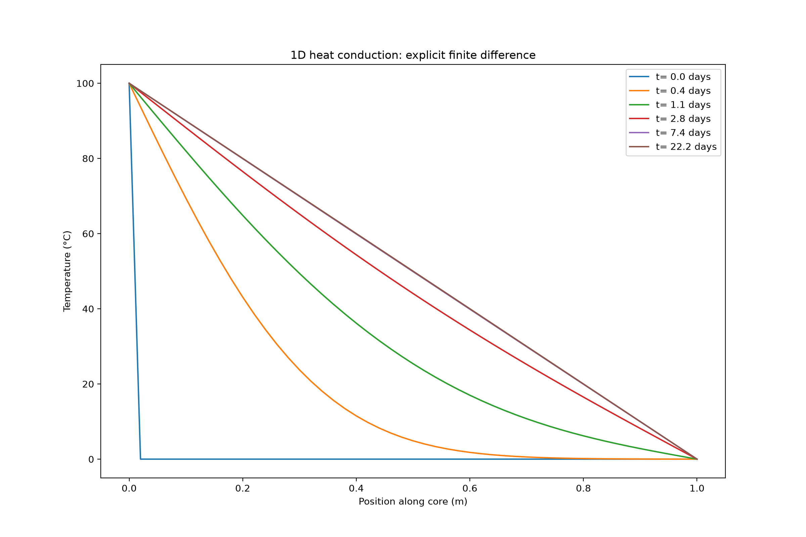
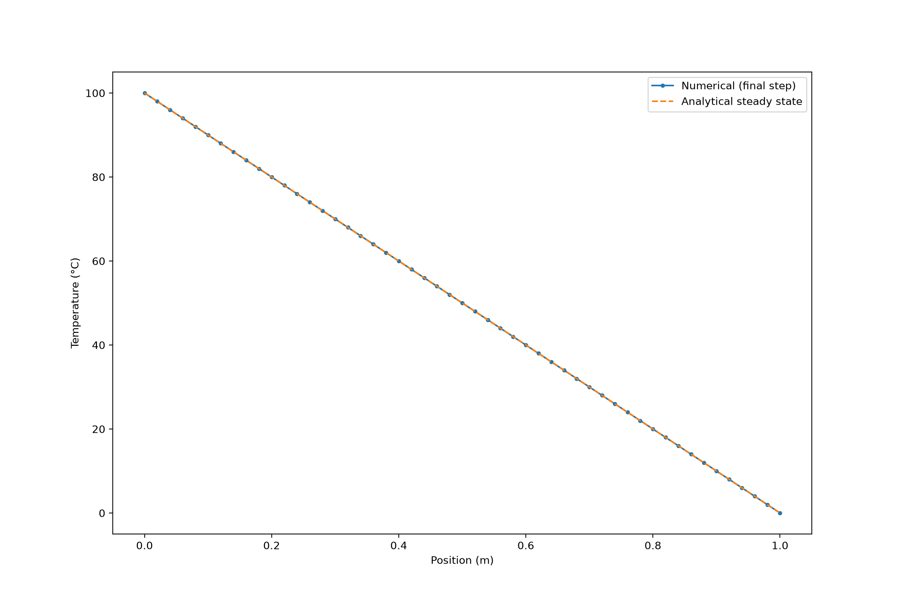
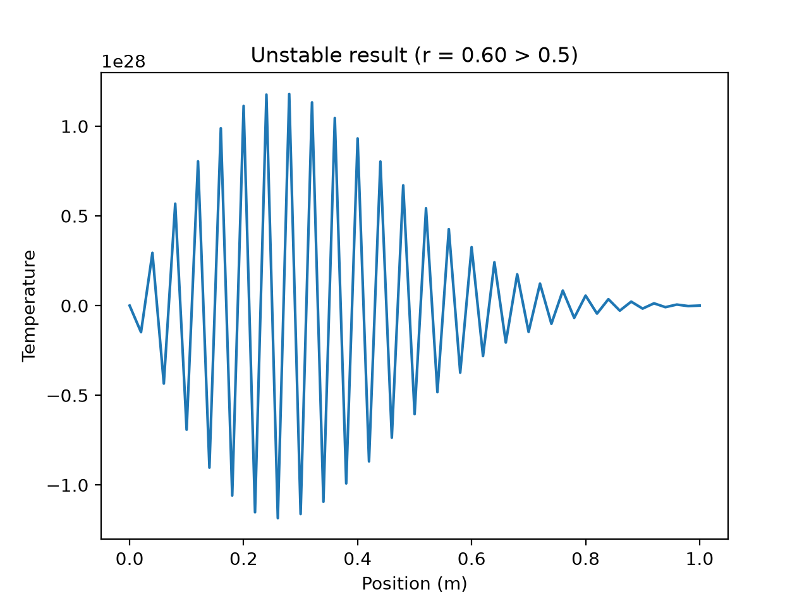

# 1D Heat Conduction - Explicit Finite Difference

Explicit finite-difference solution of 1D heat conduction along a rock core, verified against the analytical steady state.



## What this does

- Domain: L = 1 m, 50 grid intervals (dx = 0.02 m)
- Thermal diffusivity: 1e-6 m^2/s (typical order of magnitude for rock)
- Initial condition: 0 deg C everywhere
- Boundary conditions: fixed 100 deg C at x = 0 and 0 deg C at x = L
- Scheme: explicit (forward Euler in time, central difference in space)
- Stability number r = alpha*dt/dx^2 = 0.4 (dt = 160 s), 12,000 steps = 22.2 days simulated

The profiles above show the temperature relaxing from the initial state toward the linear steady state.

## Verification

At the final step, the numerical solution is compared with the analytical steady state T(x) = 100 (1 - x/L):



Maximum deviation: 3.7e-7 deg C

The discrete steady state of this scheme is exactly linear, so this small deviation reflects the remaining transient (the run covers about 1.9 diffusion times L^2/alpha), not a discretization error.

## Stability

The explicit scheme is stable only for r = alpha*dt/dx^2 <= 0.5. With r = 0.6 the solution blows up within 200 steps (values around 1e28 instead of staying between 0 and 100 deg C):



## How to run

```
pip install numpy matplotlib
python heat_conduction_1d.py
```

The script prints the stability number and the maximum deviation, and saves the figures to the `figures/` folder.

## Limitations

- Constant material properties, 1D only
- Fixed-temperature (Dirichlet) boundaries
- Explicit scheme: the time step is limited by the stability condition
